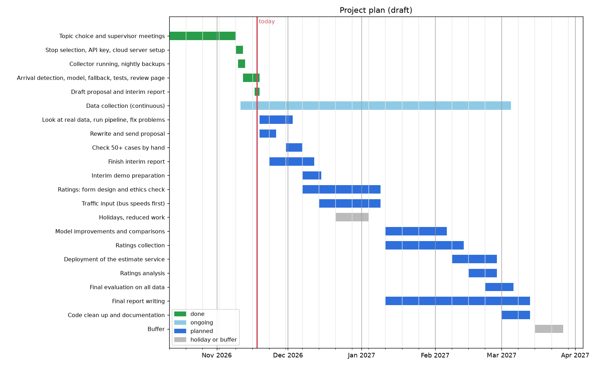

# Improving Bus Arrival Time Predictions on the 41C in Swords

Interim Report

Miron Nekrasovs, C22486382, TU856 Computer Science

Supervisor: [supervisor name]

[date]

Anything in square brackets is something I still have to fill in or check before submitting.

---

## 1. Introduction

The TFI app and the real time displays at bus stops tell passengers when the next bus is due. Anyone who uses a route regularly knows that these times are not always right. A bus can show as due for several minutes and then not turn up, or it can disappear from the list early. I take the 41C from the Boroimhe Laurels stop (stop number 5029) in Swords, Co. Dublin, so I have a good idea of how this feels in practice.

This project asks whether the arrival times published by TFI can be made more accurate by combining them with information that is available at the same time: the time of day and day of the week, the weather, the live position of the bus and, later in the project, traffic and ratings from passengers. The focus is on predictions made 30 or 60 minutes ahead, since that is when someone decides whether to leave the house or wait.

The work so far covers the foundations the rest of the project depends on. A collector has been running on a cloud server since 11 November 2026 and stores TFI's predictions, the live bus positions and the weather every minute. I have built a way of working out when buses really arrived, a first prediction model, a way of comparing it against TFI that I can trust, a fallback for when TFI is not available, and an automated set of tests with a page for checking results by eye. The code is on GitHub at [repository link].

## 2. Aims and Objectives

**Aim.** To build and evaluate a system that predicts bus arrival times for the 41C more accurately than the times published by TFI, at prediction horizons of 30 and 60 minutes.

**Research questions.**

1. How much does TFI's predicted arrival time differ from the actual arrival time at a 30 and 60 minute horizon?
2. Can a model that uses time of day, weather and the live bus position reduce that difference, and by how much?
3. Do passenger ratings improve predictions, or are they noise? (planned, see section 7)

**Objectives.**

1. Collect predictions, bus positions and weather for stop 5029 and five nearby stops on the 41C, continuously. (done)
2. Work out actual arrival times from the collected data and compare two ways of doing it. (done, results on real data to come)
3. Build a prediction model and an evaluation that can say honestly whether it beats TFI. (first version done)
4. Keep the system giving an estimate when TFI is down or returning bad data. (done)
5. Automate the testing so the whole chain can be checked in one command, with a human check alongside. (done)
6. Add traffic and passenger ratings and test whether each one helps. (to do)
7. Deploy the working system. (to do, after the tests pass on real data)

## 3. Background and Related Work

### 3.1 Existing apps

Several apps show live bus times in Dublin. The TFI Live app and the stop displays show predicted arrival times taken from the National Transport Authority (NTA) real time system. General apps such as Google Maps, Citymapper, Moovit and Transit also show real time arrivals for Dublin where they can get the feed. As far as I have seen, these apps show the predicted time and nothing about how reliable that prediction has been in the past. [Check this properly before submitting and add what I find, with screenshots.]

### 3.2 Predicting bus arrival times

The research on bus arrival time prediction covers a few families of method. The simplest uses the timetable or the average of past journey times for the same time of day. Regression models add inputs such as weather and traffic. Tree based methods such as random forests and gradient boosting handle mixed inputs and small datasets well. Neural networks, mainly recurrent ones such as LSTMs, are often used when there is a lot of data. Kalman filters are a common choice for updating an estimate as a bus moves along its route. [Add 5 to 10 papers here with a sentence on each. I have deliberately not listed any yet because I have not read and checked them.]

A point that came up in the reading and in meetings is that most published work predicts the journey time from scratch. Here there is already a prediction from the transport authority, so the more useful question is how far off that prediction tends to be and whether the error follows a pattern that can be learned. That is the approach taken in section 4.

### 3.3 Technology alternatives

For each part of the system I looked at other options before choosing. The reasons are summarised below.

**Data source.**

| Option | Notes | Decision |
| --- | --- | --- |
| NTA GTFS-Realtime API | Official, free with an API key, gives predicted arrival times and vehicle positions for the whole country in a standard format (protocol buffers). Static timetable data is a separate download. | Used |
| Older real time passenger information web services (for example the Dublin Bus one published through Smart Dublin) | Per stop queries, plain text or JSON. Would need many requests for many stops and [check whether it is still maintained]. | Not used |
| Scraping the TFI website or app | Unofficial, can break at any time, may break the terms of use. | Not used |

One request to the GTFS-R API returns every bus in the country, which I filter locally. This means two requests a minute are enough, rather than one per stop, which also answers the question of whether the polling rate would be a problem.

**Prediction method.**

| Option | For | Against |
| --- | --- | --- |
| Timetable or historical average only | Very simple, good baseline | Ignores current conditions |
| Linear or ridge regression | Simple, easy to explain | Cannot capture effects like rush hour combined with rain without hand made features |
| Gradient boosting (chosen) | Works on small tabular data, handles different kinds of input, gives feature importances | Needs care to avoid overfitting |
| LSTM or other neural networks | Can model sequences | Needs far more data than I will have and is harder to explain |
| Kalman filter | Good for tracking a bus along a route | Needs position data along the whole route, more than the six stops studied here |

**Storage.**

| Option | Notes | Decision |
| --- | --- | --- |
| SQLite | One file, no server to run, easy to back up and copy to a laptop, fine for a few million rows | Used |
| PostgreSQL | More robust for several users writing at once | Overkill for one writer, could move to it if the project is extended |
| Time series databases (InfluxDB, TimescaleDB) | Built for this kind of data | Extra thing to install and learn for little gain here |
| CSV or Parquet files | Simple | No safe way to write while reading |

**Hosting.**

| Option | Notes | Decision |
| --- | --- | --- |
| Google Compute Engine, e2-micro | Small, always on, mostly covered by the free tier in some US regions, a few dollars a month for the public IP address | Used |
| AWS or Azure | Similar capability, no clear advantage for this | Not used |
| Raspberry Pi at home | Cheap, but depends on my home internet and power | Not used |
| University server | [Ask the supervisor whether one is available] | Not used |

**Weather and traffic.**

| Option | Notes | Decision |
| --- | --- | --- |
| Open-Meteo | Free, no key, current conditions and history | Used for weather |
| Met Eireann open data | Official, [check format and update rate] | Possible later |
| Google Maps, TomTom or HERE traffic APIs | Live traffic, but paid or limited free tiers, [check current prices] | Under consideration |
| Using the buses' own speeds as a traffic measure | Free, already collected | Likely first choice for traffic |

**Languages and libraries.** Python was chosen because the feed libraries, scikit-learn and the testing tools are all there already. R would have worked for the analysis but not for the collector and the web page. scikit-learn was chosen over XGBoost or LightGBM because it is enough for this data size and is a single, well documented dependency. The review page uses only the Python standard library so there is nothing extra to install. Tests use pytest, and GitHub Actions runs them on every push.

## 4. System Design

The system has four parts, shown in the order data flows through them.

**4.1 Collection.** A Python service on the cloud server asks the NTA API for trip updates and vehicle positions once a minute and weather every ten minutes. It keeps only what is relevant: predicted arrivals at six stops on the 41C, and the position of every 41C bus. The stops are 5029 Boroimhe Laurels, 5031 Boroimhe Cherry, 5030 and 5028 Boroimhe Maples, and 6033 and 6015 Cherry Park. They were picked by taking stop 5029 and the five nearest stops on the 41C from the TFI static timetable data (the script for this is `scripts/find_stops.py`). Everything goes into SQLite. Every request, successful or not, is logged in a `polls` table so that gaps in the data can be explained later. The service runs under systemd so it restarts after a crash or reboot, and a nightly job copies the database to OneDrive.

**4.2 Finding the real arrival time.** The feed only gives predictions, so the real arrival time has to be worked out afterwards. Two methods are implemented so they can be compared.

*GPS method.* The bus is polled once a minute and moves several hundred metres between polls, so it is rarely right next to the stop in any single position. Instead I draw a straight line between consecutive positions and find the point on it closest to the stop. If that point is within 25 metres, the arrival time is worked out by interpolating between the two timestamps. Gaps of more than three minutes in the track are not trusted. This replaces the idea of waiting for a position within 10 to 20 metres, which would miss most buses at this polling rate.

*Feed method.* TFI keeps showing a bus as due for a while after it has gone. I take the first poll in which the stop is no longer listed for that trip and subtract one minute. Trips that vanish while still more than five minutes away are treated as cancelled, and trips are ignored if the collector had a gap around the time they disappeared.

Where both exist, the GPS method is used as the ground truth, and the difference between the two methods is itself a result worth reporting.

**4.3 Prediction.** For every arrival I find the moment when TFI was saying the bus was 30 (or 60) minutes away, and record TFI's predicted time together with the hour of day, whether it is a weekend, and the rain and wind at that time. The sample is chosen using what TFI said, not when the bus really arrived. An early version chose the poll 30 minutes before the real arrival, which accidentally let the real arrival time leak into the inputs and made the model look almost perfect. The tests now check for this.

The model, a small gradient boosting regressor, does not predict the arrival time directly. It predicts the correction to add to TFI's time. If there is nothing to learn, the correction goes towards zero and the prediction stays close to TFI. Two baselines are kept for comparison: TFI as it is, and TFI shifted by its typical error.

**4.4 Keeping going when TFI fails.** Before the live feed is used it goes through health checks: it must not be empty, stale or from the future, and the delays and times in it must be plausible. If the feed is unreachable or fails the checks, the system uses the stored history instead. It looks at buses on the same kind of day (weekday, Saturday, Sunday) over the last four weeks, groups them by timetable slot, and gives the typical arrival time for the next slots, along with how many past trips it is based on. The answer is marked as coming from history so the user knows.

## 5. Testing and Evaluation

### 5.1 How the system is tested

The testing follows the advice from my supervisor meeting: tests with known right and wrong answers, run automatically, in order, with a human check on top.

**Simulated data with known answers.** `bus/simulate.py` generates two weeks of data in which each bus's true arrival time is known exactly, the TFI predictions only learn about delays shortly before arrival, and the real delays depend on hour of day and rain. Because the right answer is known, the tests can check for both positive and negative outcomes:

- A bus passing the stop must give an arrival within a few seconds; a bus passing 100 m away, a long gap in the GPS track, a cancelled trip and a collector outage must not give one.
- Where delays depend on time of day, the model must beat TFI. Where delays are pure noise, the model must not be called better.
- Empty, stale and nonsense feeds must be rejected.
- If TFI is unreachable, stale or nonsense, an estimate must still come out, marked as coming from history.

**System test.** `tests/test_system.py` starts a fake TFI server and runs the real collector code against it, then the database, the arrival detection and the live estimate, one after the other, including a simulated TFI outage.

**Staged pipeline.** `scripts/run_pipeline.py` runs everything in sequence and stops at the first failure: unit tests, quality of the stored data, a check of the live feed, arrival detection, accuracy against TFI, the fallback, and the human review score. Each stage ends in pass, fail, skip (not enough data yet) or TFI fault. The last one is for when the live feed itself looks broken. That is reported but not counted as a failure of my own code, which is how the problem of checking live data against errors on TFI's side is handled. GitHub runs the pipeline on simulated data for every push, and deployment will only happen once it passes on real data too.

**Human check.** A small web page (`python -m bus.review`) shows one bus at a time, with a chart of its distance from the stop, the detected arrival and what TFI and the model each predicted. I answer one question: does the detected arrival look right. The answers are stored and the last pipeline stage fails if my agreement falls under 80 percent.

### 5.2 How accuracy is measured

- The data is split by day. The model is trained on earlier days and tested on later ones, so it is never tested on the future it was trained on.
- Measures are mean absolute error, median absolute error, root mean squared error, bias, and the share of predictions within one and two minutes of the real arrival.
- To say whether the model really beats TFI, a paired bootstrap gives a 95 percent interval for the average number of seconds saved per bus. The result is only called better if the whole interval is above zero, and worse if it is all below. Otherwise it is inconclusive.
- The same idea is used to test inputs. The model is retrained with a group of inputs removed (time of day, weather), and the group is kept only if removing it makes the error on unseen days worse. This is also how passenger ratings will be tested: kept if they help, treated as noise if they do not.

## 6. Progress So Far

### 6.1 Summary

| Item | Status |
| --- | --- |
| Cloud server collecting data every minute | Running since 11 November 2026 |
| Nightly backup to OneDrive | Running |
| Arrival detection (GPS and feed methods) | Done, tested |
| Prediction model and comparison with TFI | First version done |
| Feed health checks and fallback estimate | Done, tested |
| Automated tests and pipeline | 65 tests, run by GitHub on every push |
| Human review page | Done |
| Traffic data | Not started |
| Passenger ratings | Not started |
| Deployment | Waiting for passing results on real data |

### 6.2 Results on simulated data

The first set of figures is from the simulated data and only shows that the tools work: when an effect exists they find it, and when it does not they do not invent one. They say nothing about the real 41C.

| Check | Result |
| --- | --- |
| GPS method, 714 simulated arrivals | average error 0.4 s, worst 4.3 s |
| Feed method, same arrivals | on average 51 s late, between 67 s early and 173 s late |
| Model vs TFI at 30 minutes, effects present | error 0.85 min against 1.39 min, saving 23 to 41 s per bus, verdict better |
| Model vs TFI at 60 minutes, effects present | error 0.84 min against 1.62 min, saving 35 to 58 s per bus, verdict better |
| Model vs TFI at 30 minutes, nothing to learn | error 0.81 min against 0.80 min, interval spans zero, verdict inconclusive |
| Fallback on the latest day, 51 buses | average error 0.8 min |

The feed method being late on average is built into the simulation, since it makes TFI keep showing buses for up to three minutes. It is there to check the tools notice it. On real data this comparison will show how well the "subtract a minute" rule works.

### 6.3 Results on real data

[Fill this in from the real database. Copy the database from OneDrive to `data/bus.db` and run:

```
python scripts/status.py
python scripts/run_pipeline.py --json results.json
python -m bus.evaluate --horizon 30 60
python -m bus.evaluate --horizon 30 60 --truth feed
```

Then report: number of days collected, number of arrivals found, the share found by each method, how far apart the two methods are, and the table of TFI against the model at each horizon. Also report any collection gaps from the data quality stage and how many cases I checked by hand and how often I agreed. If the model does not beat TFI yet, say so. That is still a result.]

| Horizon | n (test) | TFI error (min) | Model error (min) | Saving per bus (95% interval) | Verdict |
| --- | --- | --- | --- | --- | --- |
| 30 min | [ ] | [ ] | [ ] | [ ] | [ ] |
| 60 min | [ ] | [ ] | [ ] | [ ] | [ ] |

### 6.4 Problems found along the way

- The first version of the sampling leaked the answer into the model, as described in section 4.3. It was caught because the model's results on simulated data were too good to be true, and a test now guards against it.
- A 25 metre radius around the stop would miss nearly every bus at one poll a minute, which is why the arrival is interpolated between positions.
- Stop 5031 is only 31 metres from the main stop, so [check whether it is on the opposite side of the road and how this affects GPS matching].
- The route identifier in the live feed ("1 41C c a") comes from the static timetable and could change when TFI publishes a new timetable. If the collector suddenly stores nothing, `scripts/find_stops.py` needs to be run again.

## 7. Plan for Remaining Work, Risks and Ethics

### 7.1 Plan

| Period | Work |
| --- | --- |
| 19 Nov to 3 Dec | Run the full pipeline on real data and fix what it finds |
| 30 Nov to 7 Dec | Check at least 50 cases by hand |
| 7 Dec to 9 Jan | Design the ratings form and sort out ethics approval |
| 14 Dec to 9 Jan | Add a traffic input, starting with the buses' own speeds |
| 11 Jan to 6 Feb | Improve the model and compare it with other models |
| 11 Jan to 13 Feb | Collect passenger ratings, then test them (15 to 27 Feb) |
| 8 Feb to 27 Feb | Deploy the estimate service with the fallback |
| 22 Feb to 6 Mar | Final evaluation on all the data |
| 11 Jan to 13 Mar | Write the final report, then clean up the code |
| 15 to 27 Mar | Buffer before the final submission [check deadline] |

Figure 1 shows the plan as a chart, including what has been done. The dates are a draft and will be adjusted to the official deadlines.




### 7.2 Risks

| Risk | What I will do |
| --- | --- |
| Not enough data for the model to learn from | Keep the collector running, report confidence intervals, make the model fall back towards TFI |
| Gaps in the collection | The poll log shows them, the quality stage reports them, the backups limit the loss |
| TFI changes its identifiers or feed | The live health checks and the zero rows check will show it quickly |
| Ground truth is wrong | Two methods and the manual review page |
| Results are good on one stop only | Say so clearly, test on the other stops separately |
| Ratings are too few or not useful | Test them as an optional input, report the outcome either way |

### 7.3 Ethics and data

The data collected so far is public transport data and weather, with no personal information. Ratings from passengers would be different, so before collecting any I will check what TU Dublin requires for ethics approval and consent, and keep ratings anonymous. NTA data is published as open data and I will check and follow the licence terms and credit the source. [Check the licence wording.]

## 8. Conclusion

The collection, ground truth, comparison, fallback and testing are in place and working on simulated data, and the collector is building up the real dataset. The next step is running everything on real data to find out how accurate TFI's predictions really are at 30 and 60 minutes and whether the model improves on them. Traffic and passenger ratings come after that, and deployment follows once the tests pass on real data.

## References

1. GTFS Realtime specification. https://gtfs.org/realtime/
2. National Transport Authority developer portal. https://developer.nationaltransport.ie
3. Open-Meteo weather API. https://open-meteo.com
4. Pedregosa, F. et al. (2011). Scikit-learn: Machine learning in Python. Journal of Machine Learning Research, 12, 2825 to 2830.
5. Friedman, J. H. (2001). Greedy function approximation: a gradient boosting machine. Annals of Statistics, 29(5), 1189 to 1232.
6. Efron, B. (1979). Bootstrap methods: another look at the jackknife. Annals of Statistics, 7(1), 1 to 26.
7. [Papers on bus arrival time prediction, to be added after reading]
8. [Any documentation for the other technologies discussed in section 3.3 that I rely on]
