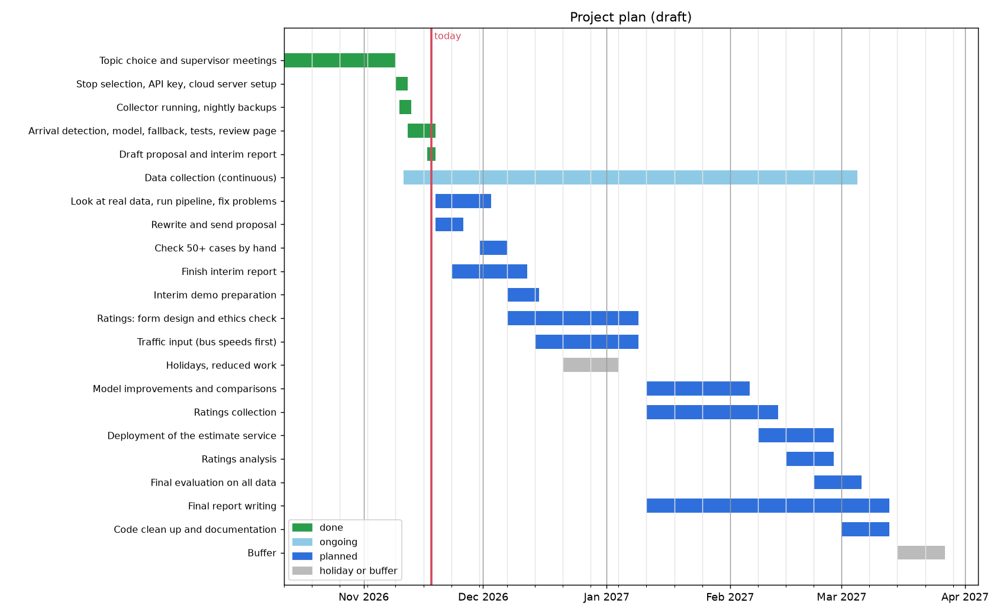

# Project Plan (draft)

Dates are my best guess. Check them against the official deadlines for the proposal, the interim report, the demo and the final submission, and move things around where they differ. The final submission date is assumed to be near the end of March 2027.

## Done so far

| Task | When | Notes |
| --- | --- | --- |
| Topic choice and supervisor meetings | mid October to 9 Nov | |
| Stop selection, API key, cloud server setup | 9 to 11 Nov | 6 stops on the 41C around stop 5029 |
| Collector running, nightly backups | 10 to 12 Nov | collecting since 11 Nov |
| Arrival detection, model, fallback, tests, review page | 12 to 18 Nov | 65 tests, pipeline script, GitHub checks |
| Draft proposal and interim report | 17 to 18 Nov | drafts to be rewritten by me |

## Still to do

| Task | Start | End | Length | Why this long |
| --- | --- | --- | --- | --- |
| Data collection (continuous) | 11 Nov | 5 Mar | about 16 weeks | Runs by itself. Stop a week or two before the final evaluation so the numbers can be frozen. |
| Look at real data, run pipeline, fix problems | 19 Nov | 3 Dec | 2 weeks | First contact with real data nearly always finds something (missing fields, odd stops, gaps). |
| Rewrite and send proposal | 19 Nov | 26 Nov | 1 week | The text exists already, the work is checking facts and rewriting in my own words. It is overdue so this goes first. |
| Check 50+ cases by hand | 30 Nov | 7 Dec | 1 week | About 2 minutes a case, spread over a few sittings. |
| Finish interim report | 23 Nov | 12 Dec | about 3 weeks | Needs the real results from the line above, so it runs alongside. Check the real deadline. |
| Interim demo preparation | 7 Dec | 15 Dec | 1 week | Short demo with the latest version. No slides beyond what is needed. |
| Ratings: form design and ethics check | 7 Dec | 9 Jan | 4 weeks elapsed, a few days of effort | Ethics approval can take weeks, so start early. |
| Traffic input (bus speeds first) | 14 Dec | 9 Jan | 3 weeks, slowed by holidays | Compute average bus speed near the stops from stored positions, test it as another input. A paid traffic API is only worth it if this shows promise. |
| Holidays, reduced work | 21 Dec | 4 Jan | 2 weeks | Check exam dates too and adjust. |
| Model improvements and comparisons | 11 Jan | 6 Feb | 4 weeks | Tune the model, compare with simpler and more complex ones, check each stop and each horizon. |
| Ratings collection | 11 Jan | 13 Feb | 5 weeks | Needs time to get enough responses. Realistically a few dozen to a couple of hundred. |
| Deployment of the estimate service | 8 Feb | 27 Feb | 3 weeks | A simple page or command that gives the next estimate with the TFI fallback, running on the same server. Only after the pipeline passes on real data. |
| Ratings analysis | 15 Feb | 27 Feb | 2 weeks | Test whether ratings help (keep) or are noise (drop). |
| Final evaluation on all data | 22 Feb | 6 Mar | 2 weeks | Freeze the data, rerun everything, produce the final tables and charts. |
| Final report writing | 11 Jan | 13 Mar | 9 weeks, low intensity | Write chapters as results arrive (background and design first, results last). |
| Code clean up and documentation | 1 Mar | 13 Mar | 2 weeks | Readable code, short README, tests still passing. |
| Buffer | 15 Mar | 27 Mar | 2 weeks | For things running late. |

## If time runs short

Cut in this order: passenger ratings (report it as future work and keep the method), then other models (keep just the one), then the paid traffic option. The collection, the comparison against TFI, the fallback and the testing are the core and should not be cut.

## Milestones to keep an eye on

- Proposal sent to supervisor: end of November
- First real results (even if the model does not beat TFI): early December
- Interim report and demo: [check deadline], planned for mid December
- Ratings ethics approval in place: early January
- Freeze data and rerun the evaluation: early March
- Final submission: [check deadline], planned for late March
